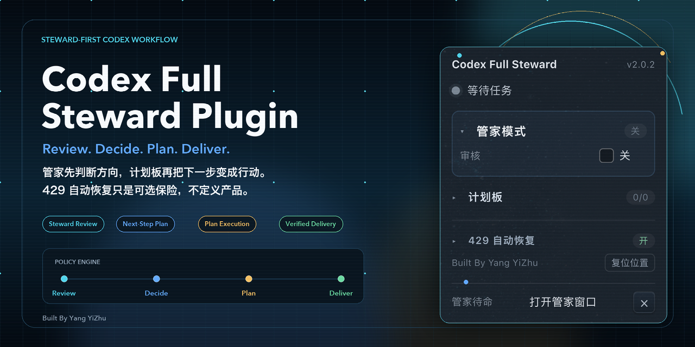
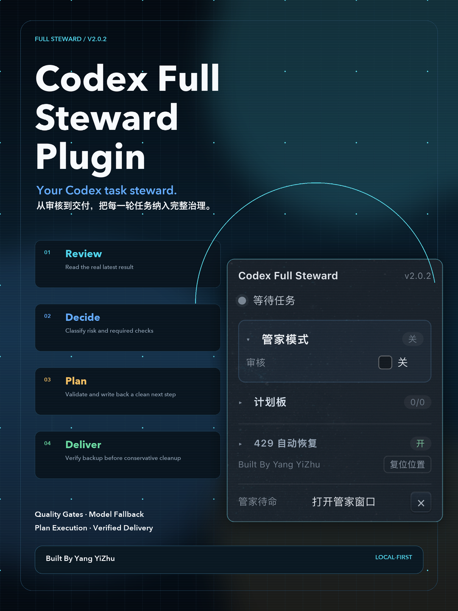
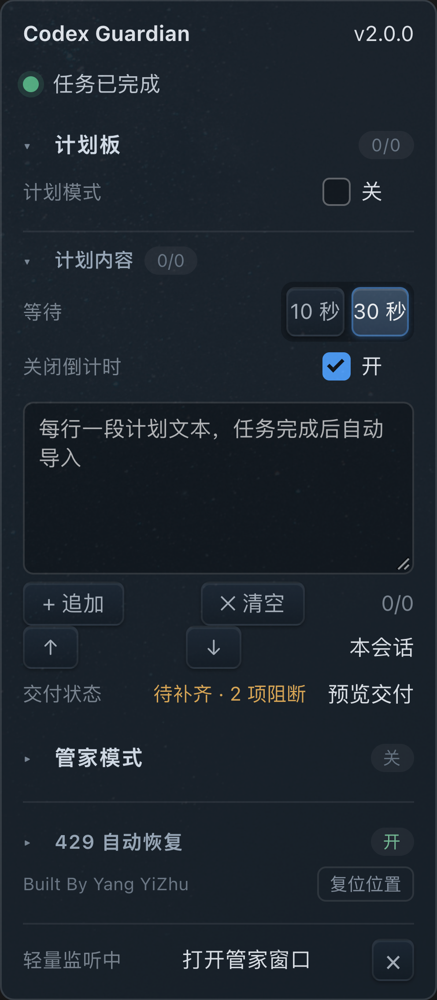

# Codex Full Steward Plugin

> **Review. Decide. Plan. Deliver.**
>
> A local-first AI task steward for Codex desktop: quality gates, model fallback, plan execution, verified delivery, conservative cleanup, and unattended review.

[](#)
[](#)
[](#verification)
[](LICENSE)



<details>
<summary>Vertical product poster</summary>



</details>

## What It Is

Codex Full Steward Plugin turns a finished Codex task into a governed next step.

It reads the latest task result and project context, applies deterministic task-level quality checks, asks an LLM to synthesize risks and the next plan, then writes only the clean, validated instruction back to the plan board. When the project is genuinely ready, it builds a verified delivery archive before moving conservative runtime cleanup candidates to Trash.

It is not another coding agent. It is a **steward layer for Codex desktop**.

```text
Task completes
  -> policy engine classifies risk and required checks
  -> steward reads current output, project docs, Git state, and plan
  -> primary LLM analyzes; fallback model takes over on failure
  -> deterministic validator rejects vague, ungrounded, or prep-only plans
  -> clean plan returns to the plan board
  -> countdown starts the next task
  -> delivery becomes available only after quality and backup gates pass
  -> user confirms twice; backup is verified; only safe runtime files move to Trash
```

## Product Priority

1. **管家模式 is the primary product surface.** It reads the completed task, forms a project-level judgment, identifies real gaps, and produces the next executable decision.
2. **计划板 is the execution surface.** It receives only clean, evidence-grounded instructions and turns them into the next Codex task after the current result is complete.
3. **429 recovery is an optional resilience layer.** It sits folded at the bottom and never defines the product.



## Session Binding and Memory

Every plan and steward review is bound to the currently open Codex session, using its sidebar UUID and visible session title. Plan boards no longer fall back to a shared `default` bucket.

When steward mode is enabled, the plugin queues a one-time memory-folder instruction for that session. The native daemon also provisions:

```text
.guardian/sessions/s_<session-uuid>/
├── SESSION.json
├── SESSION-STATE.md
├── LATEST-CONTEXT.md
├── STEWARD-SUMMARY.md
└── context-cache.json
```

The daemon reads only the current session's private directory plus project-level documents. Session-specific Markdown from another UUID is rejected.

## Core Capabilities

### Steward Responsibilities

- Task classification: micro, feature, high-risk, and delivery.
- Required checks by task type.
- Evidence-grounded plan validation.
- Duplicate-plan prevention and session isolation.
- Explicit evidence requests when project context is insufficient.
- Delivery readiness computed by code, never by the model alone.

### Model Resilience

- OpenAI, Anthropic, DashScope, DeepSeek, OpenRouter, Ollama, and custom OpenAI-compatible endpoints.
- Primary and fallback provider profiles.
- Immediate fallback on authentication failure.
- Retry and fallback for timeouts, network errors, 429s, and 5xx responses.
- Provider cooldown after repeated transport failures.
- Credentials stored in macOS Keychain, not local storage.

### Plan Execution

- Per-session plan boards.
- Editable, reorderable, and clearable plan entries.
- 30-second default countdown with pause and manual-import options.
- Auto-import only after the current task is complete and its result is stable.
- Draggable floating panel with saved position and reset.

### Verified Delivery

- Manual delivery readiness.
- Preview of included files, exclusions, and cleanup candidates.
- Two-step confirmation.
- ZIP, `MANIFEST.json`, `SHA256SUMS`, and delivery README.
- Project fingerprint check aborts delivery if files change during backup.
- Conservative cleanup moves only steward runtime caches and temporary files to Trash.

### Optional 429 Recovery

- Detects localized 429/reconnect states.
- Waits, clicks the explicit retry control, and verifies task recovery.
- Monitors background sessions.
- Keeps working after transient desktop/network failures.

## Installation

See [INSTALL.md](INSTALL.md) for full requirements and troubleshooting.

```bash
git clone https://github.com/repo-lens/Codex-Full-Steward-Plugin.git
cd Codex-Full-Steward-Plugin
bash install.sh
```

Then open Codex, reload the window, and enable the required switches in the panel.

### Requirements

- macOS
- Codex desktop app
- Codex bundled Node runtime:

```text
/Applications/ChatGPT.app/Contents/Resources/cua_node/bin/node
```

- A supported provider API key or a local Ollama endpoint

## Quick Start

1. Open the Full Steward panel from the **管家** pill.
2. Set the project root.
3. Choose a Provider and model.
4. Save the API key to macOS Keychain.
5. Optionally configure a fallback Provider/model.
6. Enable the steward.
7. Choose a review focus.
8. Let the plan board start the next task.
9. When the delivery state becomes **可确认交付**, preview and confirm twice.

Full usage: [USAGE.md](USAGE.md)

## Provider Setup

| Provider | Protocol | Notes |
|---|---|---|
| OpenAI | OpenAI | Official and compatible models |
| Anthropic | Anthropic Messages | Claude models |
| DashScope | OpenAI-compatible | Alibaba Cloud models |
| DeepSeek | OpenAI-compatible | DeepSeek models |
| OpenRouter | OpenAI-compatible | Multi-model routing |
| Ollama | OpenAI-compatible local endpoint | No Keychain credential required |
| Custom | OpenAI-compatible | Any compatible endpoint |

Credentials are stored under Keychain service `codex-guardian`.

## Delivery Safety

Delivery is intentionally conservative:

- Required plan entries must be complete.
- Required quality checks must pass.
- No unresolved review error may remain.
- A preview must be shown.
- The user must confirm twice.
- The archive must pass ZIP and SHA-256 verification.
- Cleanup runs only after verification succeeds.
- Source, docs, tracked files, evidence Markdown, configuration, and user outputs are never cleanup candidates.

Details: [SECURITY.md](SECURITY.md)

## Architecture

```text
guardian.js
  page UI + plan board + drag + CDP bridge

steward-daemon.mjs
  native orchestration + CDP loop + request handling

policy-engine.mjs
  task levels + quality gates + delivery readiness

llm-adapters.mjs
  provider presets + retries + fallback + cooldown

credential-store.mjs
  macOS Keychain adapter

delivery-manager.mjs
  preview + ZIP + manifest + hashes + conservative cleanup
```

Full design: [ARCHITECTURE.md](ARCHITECTURE.md)

## Competitive Position

Coding-agent products such as Claude Code, Cline, OpenHands, Aider, Codex CLI, and GitHub Copilot are primarily focused on creating code or executing delegated tasks.

Codex Full Steward Plugin focuses on the layer after and between those tasks in **Codex desktop**:

- review the real latest result;
- enforce quality policy;
- decide whether another task is justified;
- write a clean next plan;
- keep the loop running;
- verify delivery and clean safely.

It works alongside Codex rather than replacing the coding agent.

Read the source-backed comparison: [COMPETITIVE-ANALYSIS.md](COMPETITIVE-ANALYSIS.md)

## Verification

- Unit tests: **145/145**
- Real CDP E2E: **10/10**
- Functional and strategy round: **10/10**
- Safety and delivery round: **10/10**
- UI overlap audit: **0 overlaps**
- Installed artifact hash matched repository source during release verification

See [SCORECARD.md](SCORECARD.md)

## Comprehensive Score

**9.4 / 10**

Strong for local production use and small-team commercial pilots. Remaining risks are primarily external-provider variability, Codex DOM/CDP changes, and the need for broader non-code task samples.

## Documentation

- [INSTALL.md](INSTALL.md)
- [USAGE.md](USAGE.md)
- [ARCHITECTURE.md](ARCHITECTURE.md)
- [SECURITY.md](SECURITY.md)
- [SCORECARD.md](SCORECARD.md)
- [COMPETITIVE-ANALYSIS.md](COMPETITIVE-ANALYSIS.md)

## License

MIT. See [LICENSE](LICENSE).

**Built By Yang YiZhu**
